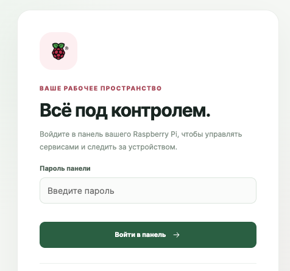
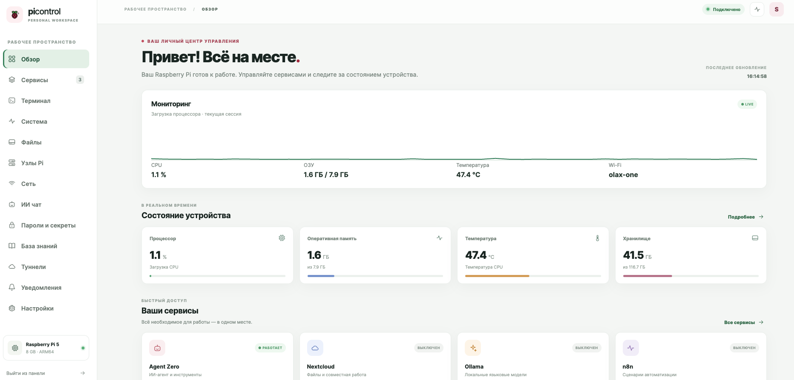
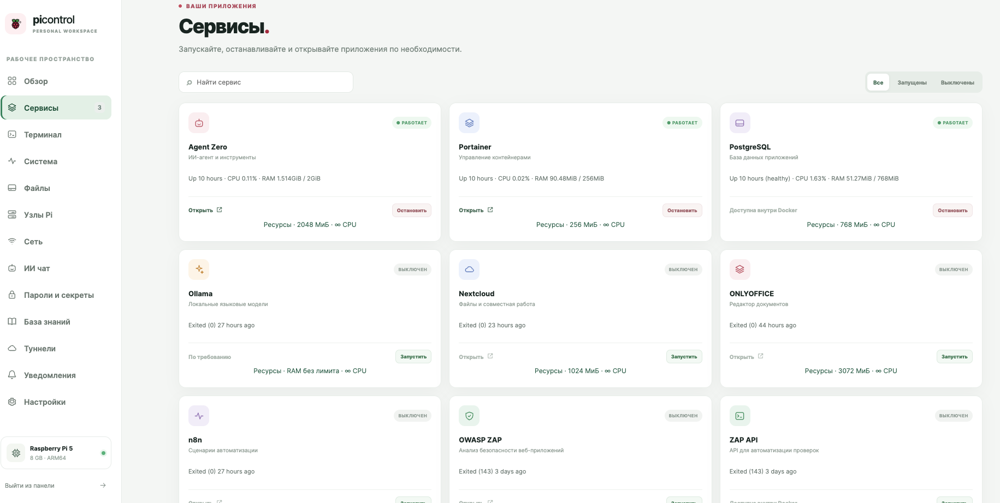
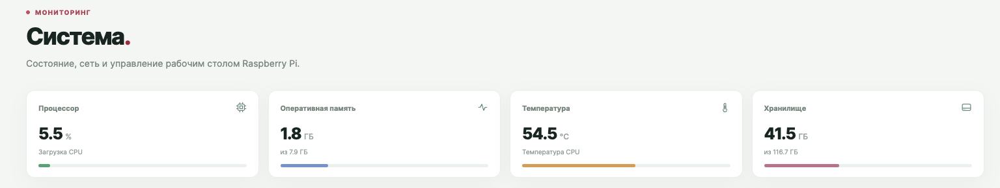
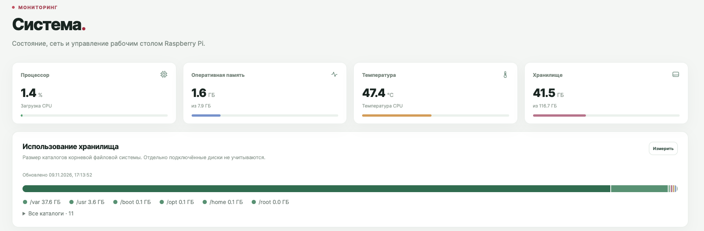
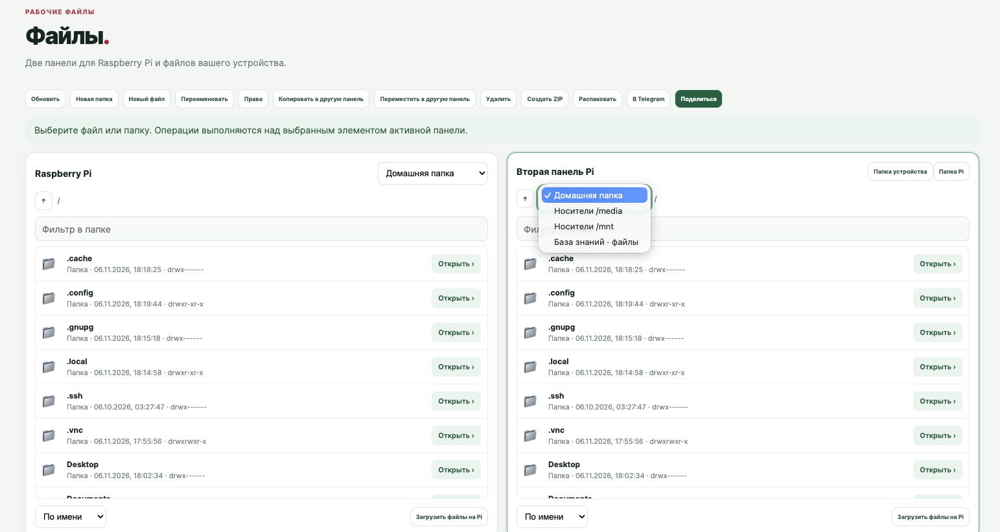

# Pi Control

**A lightweight control panel for a portable Raspberry Pi workspace.**

[Русская версия](README.ru.md) · [Architecture](docs/ARCHITECTURE.md) · [Installation](docs/INSTALLATION.md) · [User guide](docs/USER-GUIDE.md) · [Node installer](docs/NODE-INSTALL.md) · [Source snapshot](src/)

> **Development snapshot, not a turnkey release.** This repository contains the available panel source, captured on 9 November 2026. It has not been reconciled with the running Raspberry Pi since capture. Host scripts, container definitions, service units, runtime configuration and some image assets are missing. A clean installation cannot yet reproduce the running system. Do not run this snapshot on an exposed network or use it as a production installer.

Pi Control is intended to make a Raspberry Pi useful as a portable companion for a phone or computer: manage selected containers, inspect device status, browse files, use a terminal, and connect additional Pi nodes. The interface is currently Russian; a complete English UI is not implemented.

## Product preview

These are actual screenshots supplied by the project owner from an earlier version. They show the Russian interface and may differ from the present source. Network addresses are omitted from the monitoring crop.

### Sign in



### Overview



### Services



### Monitoring





### Two-pane files



## Capabilities in this snapshot

- **Overview and monitoring:** CPU/load, memory, storage, temperature and system information, depending on host support.
- **Services:** status and controls for selected Docker services and host workflows. Service actions rely on host-specific commands and Docker resources that are not included in this snapshot.
- **Files:** a two-pane browser for selected local roots, selected browser-device operations, archives, sharing and Telegram integration. SSH-node file browsing and limited upload/download exist; cross-node transfer and complete remote file operations are not implemented.
- **Terminal:** browser terminal using the vendored xterm.js assets, with local and SSH-node functionality. It grants command execution and requires strong access control.
- **Pi nodes:** SSH discovery and pinned host-key connections, resource checks, assisted deployment of a lightweight node panel and basic container controls. Automatic distributed workload scheduling is not implemented.
- **Lightweight node panel:** overview, monitoring, network, Tailscale route status, read-only settings and browsing/downloading files under `/home`; Docker start/stop. This is not a full installation of the main panel.
- **Other integrated areas:** network inventory, Wi-Fi/Bluetooth, knowledge base, AI chat, KDBX vault, backup and tunnel controls. Availability depends on host tools, credentials, external services and code paths; no claim of complete or independently verified operation is made.

## Example workflows

1. Sign in to the main panel over an authenticated, trusted network. The deployed panel normally uses HTTPS and may use a self-signed certificate.
2. Open **System** to check memory, storage and temperature before starting a heavier service.
3. Open **Pi nodes**, verify the SSH host-key fingerprint out of band, inspect the host and use auto-setup only on an authorized Raspberry Pi. The remote installation requires root or passwordless sudo, supported Debian/Raspberry Pi OS, sufficient resources and an available panel port.
4. Open **Files**, choose an SSH node and browse its home directory. The current implementation limits node uploads to 1 MiB and node downloads to 8 MiB through the main panel.
5. For a remote LAN, an administrator can configure a Tailscale subnet router and approve its route in the tailnet. The main host must accept the route; container connectivity requires an independent end-to-end test. Avoid overlapping address ranges.

## Source layout

| Path | Purpose |
| --- | --- |
| `src/server.py` | Main HTTPS application and routing |
| `src/index.html`, `app.js`, `style.css` | Main interface |
| `src/filemanager.js`, `files6.py`, `nodeops10.py` | Local and SSH-node file functions |
| `src/ssh_nodes7.py`, `provision11.py`, `cluster5.py` | SSH nodes, deployment and control |
| `src/pi_node_agent.py` | Lightweight remote node panel |
| `src/terminal9.py` | Interactive terminal implementation |
| `src/vault.py` | KDBX integration |
| `docs/OPERATIONS.md` | Dependencies, recovery and deployment limitations |

The third-party xterm and fit-addon license texts are included beside their assets. No license is asserted here for the remainder of the project; the owner should choose one before public redistribution.

## Setup and safety

A safe, repeatable installation of the **main panel** from scratch is not yet available. An [experimental installer for the lightweight node only](docs/NODE-INSTALL.md) is included; it has not been tested end-to-end on a new Pi. See [operations and recovery](docs/OPERATIONS.md) for prerequisites, missing components, existing-installation inventory and the work required before an installer can be validated. The source currently contains machine-specific paths, account names and service assumptions. Do not use a legacy setup script blindly on an existing Pi.

The panel can execute commands, manage Docker and access files. Treat it as privileged administrative software. Keep it within a trusted LAN or tailnet, use separate strong credentials, verify TLS/SSH fingerprints through a trusted channel, and back up and test recovery before modifying a device. Do not commit `.env` files, KDBX databases, certificates, keys, logs, machine-specific backups or personal data.

## Status and roadmap

This snapshot does not include a complete English UI, unrestricted streaming remote file transfer, complete remote file operations, distributed scheduling, a portable one-click installer, or a verified full restoration procedure. Remote tunnel management in the lightweight panel is status-only. Additional services and resource-aware deployment require verification on each target.

## Development checks

```sh
python3 -m compileall -q src
node --check src/app.js
node --check src/filemanager.js
```

These checks only validate syntax; they do not test deployment, security, service integrations or browser behavior.
