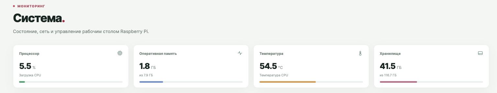
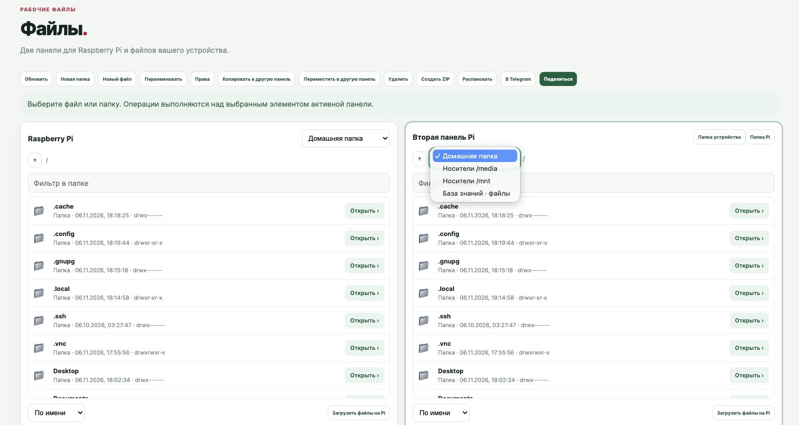

# Pi Control

**Лёгкая панель управления переносным Raspberry Pi.**

[English](README.md) · [Архитектура и эксплуатация](docs/OPERATIONS.md) · [Исходный код](src/)

> **Снимок разработки, а не готовый установочный релиз.** Репозиторий содержит доступную копию исходников панели от 9 ноября 2026 года. Сверить её с текущим состоянием Raspberry Pi не удалось. В снимке отсутствуют системные скрипты, определения контейнеров, systemd-модули, рабочая конфигурация и часть графических файлов. Установка с нуля пока не воспроизводит работающую систему.

Проект задуман как панель для Raspberry Pi в роли переносного рабочего пространства: сервисы, мониторинг, файлы, терминал и подключение других узлов. Интерфейс сейчас на русском языке; полный перевод интерфейса на английский ещё не реализован.

## Скриншоты

Скриншоты предоставлены владельцем проекта и относятся к более ранней версии. Адреса устройств удалены из изображения мониторинга.





## Возможности снимка

- Мониторинг и управление выбранными сервисами при наличии необходимых системных команд.
- Двухпанельные файлы, архивы и отдельные интеграции. Для SSH-узлов доступны просмотр и ограниченная передача файлов: загрузка до 1 МиБ, скачивание до 8 МиБ. Полноценный перенос между узлами не реализован.
- Интерактивный терминал и SSH-узлы с проверкой отпечатков. Для автоматической настройки поддерживаемого узла нужны root или sudo без пароля и достаточные ресурсы.
- Лёгкая панель узла с обзором, мониторингом, сетью, состоянием туннелей, просмотром настроек, файлами в `/home` и базовым управлением контейнерами. Автоматического распределения вычислительной нагрузки нет.
- Разделы инвентаризации сети, Wi-Fi/Bluetooth, базы знаний, ИИ-чата, KDBX, резервного копирования и туннелей зависят от окружения и сторонних компонентов; их полная работоспособность не подтверждена.

## Пример работы

1. Войдите в основную панель по доверенной сети и проверьте показатели в разделе «Система».
2. В разделе «Узлы Pi» проверьте отпечаток SSH через доверенный канал, затем проверьте ресурсы и запустите автонастройку своего устройства.
3. В разделе «Файлы» выберите SSH-узел и его домашний каталог. Учитывайте текущие ограничения размера файлов.
4. Для доступа к сети узла настройте Tailscale subnet router, утвердите маршрут в tailnet и отдельно проверьте доступ с хоста и из контейнера.

## Установка и безопасность

**Проверенного развёртывания с нуля пока нет.** Список отсутствующих компонентов и план восстановления описаны в [операционной документации](docs/OPERATIONS.md). Исходники содержат пути и имена, привязанные к исходному Raspberry Pi; старые установочные сценарии нельзя считать совместимым готовым решением.

Панель предоставляет выполнение команд, управление Docker и доступ к файлам. Используйте доверенную сеть, отдельные сложные пароли и проверку отпечатков, сохраняйте резервные копии и проверяйте восстановление. Не публикуйте секреты, KDBX, сертификаты и частные данные.

Проверки синтаксиса:

```sh
python3 -m compileall -q src
node --check src/app.js
node --check src/filemanager.js
```

Проверки синтаксиса не подтверждают работу на новом устройстве, безопасность и интеграции. Лицензия на собственный код проекта владельцем ещё не указана; лицензии встроенных компонентов xterm расположены рядом с ними.
