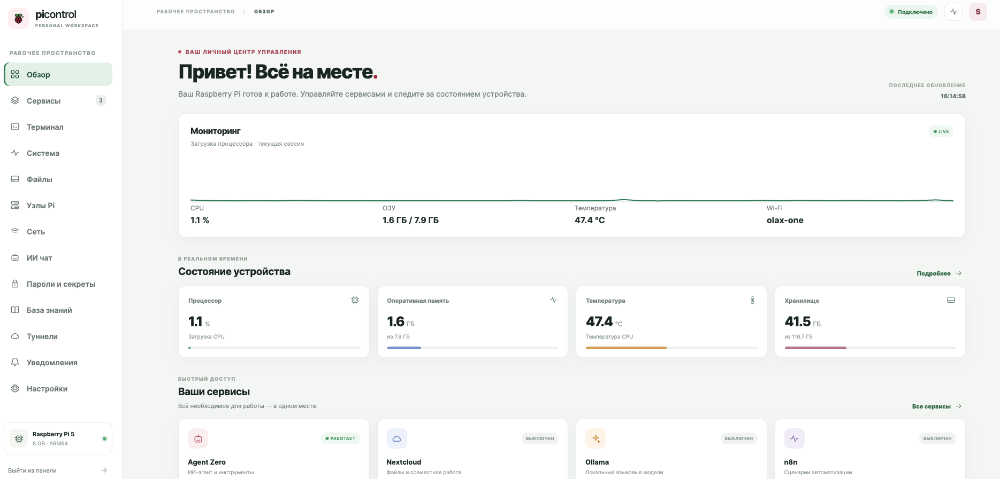
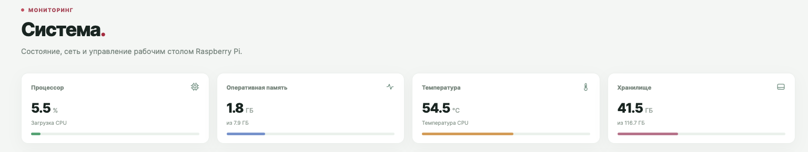

# Pi Control

**Лёгкая панель управления переносным Raspberry Pi.**

[English](README.md) · [Архитектура](docs/ARCHITECTURE.ru.md) · [Установка](docs/INSTALLATION.ru.md) · [Руководство](docs/USER-GUIDE.ru.md) · [Установщик узла](docs/NODE-INSTALL.ru.md) · [Исходный код](src/)

> **Снимок разработки, а не готовый установочный релиз.** Репозиторий содержит доступную копию исходников панели от 9 ноября 2026 года. Сверить её с текущим состоянием Raspberry Pi не удалось. В снимке отсутствуют системные скрипты, определения контейнеров, systemd-модули, рабочая конфигурация и часть графических файлов. Установка с нуля пока не воспроизводит работающую систему.

Проект задуман как панель для Raspberry Pi в роли переносного рабочего пространства: сервисы, мониторинг, файлы, терминал и подключение других узлов. Интерфейс сейчас на русском языке; полный перевод интерфейса на английский ещё не реализован.

## Скриншоты

Скриншоты предоставлены владельцем проекта и относятся к более ранней версии. Адреса устройств удалены из изображения мониторинга.








## Возможности снимка

- Мониторинг и управление выбранными сервисами при наличии необходимых системных команд.
- Двухпанельные файлы, архивы и отдельные интеграции. Для SSH-узлов доступны просмотр и ограниченная передача файлов: загрузка до 1 МиБ, скачивание до 8 МиБ. Полноценный перенос между узлами не реализован.
- Интерактивный терминал и SSH-узлы с проверкой отпечатков. Для автоматической настройки поддерживаемого узла нужны root или sudo без пароля и достаточные ресурсы.
- Лёгкая панель узла с обзором, мониторингом, сетью, состоянием туннелей, просмотром настроек, файлами в `/home` и базовым управлением контейнерами. Автоматического распределения вычислительной нагрузки нет.
- Разделы инвентаризации сети, Wi-Fi/Bluetooth, базы знаний, ИИ-чата, KDBX, резервного копирования и туннелей зависят от окружения и сторонних компонентов; их полная работоспособность не подтверждена.

## Пример работы

1. Войдите в основную панель по доверенной сети и проверьте показатели в разделе «Система».
2. В разделе «Узлы Pi» проверьте отпечаток SSH через доверенный канал, затем проверьте ресурсы и запустите автонастройку своего устройства.
3. В разделе «Файлы» выберите SSH-узел и его домашний каталог. Учитывайте текущие ограничения размера файлов.
4. Для доступа к сети узла настройте Tailscale subnet router, утвердите маршрут в tailnet и отдельно проверьте доступ с хоста и из контейнера.

## Установка и безопасность

**Проверенного развёртывания основной панели с нуля пока нет.** Добавлен [экспериментальный установщик только лёгкого узла](docs/NODE-INSTALL.ru.md), который ещё не проверен сквозным запуском на новом Pi. Список отсутствующих компонентов и план восстановления описаны в [операционной документации](docs/OPERATIONS.md). Исходники содержат пути и имена, привязанные к исходному Raspberry Pi; старые установочные сценарии нельзя считать совместимым готовым решением.

Панель предоставляет выполнение команд, управление Docker и доступ к файлам. Используйте доверенную сеть, отдельные сложные пароли и проверку отпечатков, сохраняйте резервные копии и проверяйте восстановление. Не публикуйте секреты, KDBX, сертификаты и частные данные.

Проверки синтаксиса:

```sh
python3 -m compileall -q src
node --check src/app.js
node --check src/filemanager.js
```

Проверки синтаксиса не подтверждают работу на новом устройстве, безопасность и интеграции. Лицензия на собственный код проекта владельцем ещё не указана; лицензии встроенных компонентов xterm расположены рядом с ними.

### Обновления интерфейса

Переключатель RU / ENG доступен до и после входа. Язык по умолчанию задаётся в «Настройки → Внешний вид». В разделе «Настройки → Система → Обновление Pi Control» показываются текущая версия интерфейса, новые стабильные релизы и changelog.

Скачиваемый из релиза `pi-control-ui.zip` проверяется по SHA-256, опубликованной GitHub. Кнопка обновляет JavaScript, CSS и каталог переводов. Для серверного кода применяется процедура установки. Исходная версия интерфейса — 1.0.0.

Для выпуска новой версии интерфейса увеличьте номер в `UI_VERSION` и слейте изменение в `main`. При включённых GitHub Actions workflow проверит JavaScript, соберёт пакет, сформирует changelog и опубликует стабильный релиз с готовым пакетом. Слияния без изменения версии релиз не создают. Workflow использует встроенный токен репозитория с правом `contents: write`.

KDBX можно экспортировать из открытого хранилища. На чистой установке резервная копия восстанавливается целиком. Для уже существующего хранилища доступен импорт записей.

### USB-бэкапы и уведомления

Панель автоматически показывает USB-разделы с ext4, exFAT, FAT32 и NTFS в настройках резервного копирования. Выберите накопитель, нажмите «Подготовить и создать первую копию» и дождитесь проверки. Затем можно оставить ручной режим или включить ежедневное/еженедельное расписание и запуск при подключении. Расписание использует время Минска. При подключении читаются дата, версия и размер последней копии и проверяется её SHA-256. Повреждённая копия вызывает уведомление и требует ручной проверки. Накопитель не форматируется. У FAT32 есть ограничение размера одного файла в 4 ГиБ.

Каждый комплект содержит `home.tar.gz.age`, `services.tar.gz.age` и `manifest.json`. Для расшифровки необходимо сохранить закрытый ключ age отдельно от Raspberry Pi и USB. Файл `/root/pi-backup.pub` задаёт получателя. Рабочий каталог определяется переменной `PI_BACKUP_USER` службы `pi-usb-backup.service`. Копируются домашний каталог, настройки Pi Control и выбранных сервисов, тома Docker и логический дамп работающего PostgreSQL. Для остановленной базы копируется её том. Вложенные точки монтирования домашнего каталога не обходятся. Тома моделей Ollama и временные данные контейнеров не входят в резервирование. Копии остаются на накопителе до ручной очистки. Перед постоянным использованием проверьте восстановление на отдельной машине.

Локальные уведомления доступны через колокольчик и раздел «Уведомления». Настройте пороги CPU, температуры и заполнения диска, а также уведомления о состоянии Gluetun и бэкапах. Уведомления сохраняются на устройстве. Действующая конфигурация Telegram управляется отдельно.

USB-разделы отображаются и в обоих селекторах «Файлов». Pi Control повторно использует действующее монтирование или монтирует раздел в собственный каталог.

В «Настройки → Данные → Резервное копирование → PostgreSQL · Supabase» укажите приватный Supabase Storage bucket и реквизиты S3. Локальная база выгружается в формате custom dump, шифруется age и сохраняется в bucket. Для восстановления на новом устройстве выберите архив, введите закрытый ключ и новое локальное имя БД. Кнопка копирования из Supabase PostgreSQL читает одну прикладную схему через Direct или Session pooler на порту 5432 с проверкой TLS. При импорте могут понадобиться установленные локально расширения и совместимые типы. Права и служебные схемы Supabase не переносятся.
