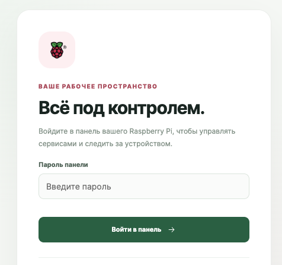
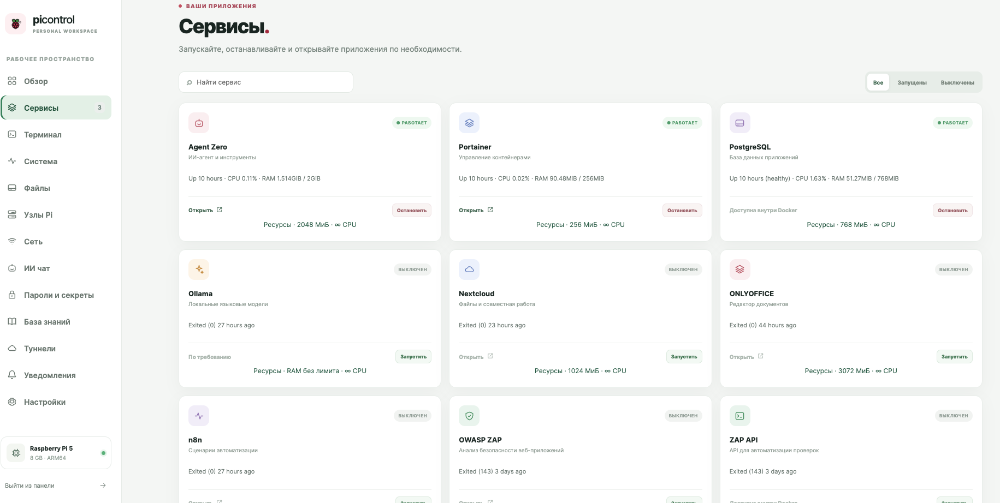
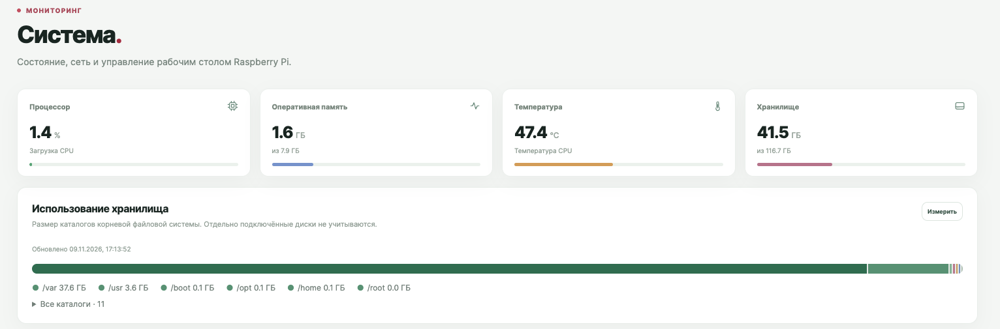
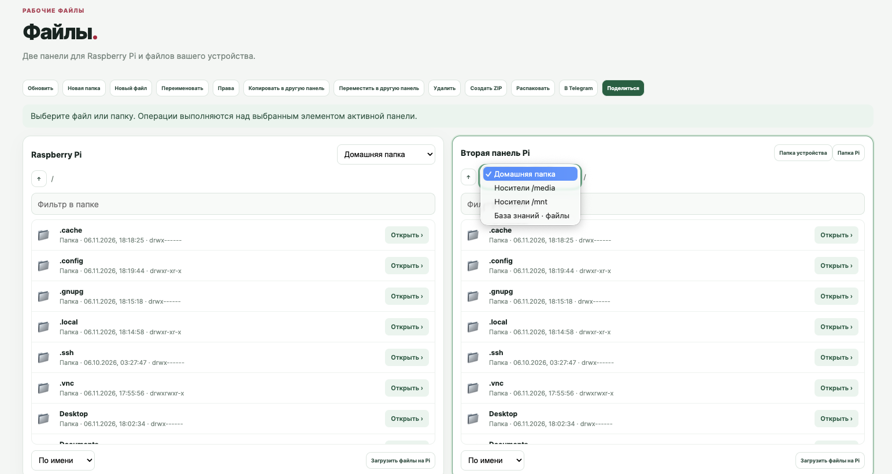

# Pi Control

**Лёгкая панель управления переносным Raspberry Pi.**

[English](README.md) · [Архитектура](docs/ARCHITECTURE.ru.md) · [Установка](docs/INSTALLATION.ru.md) · [Руководство](docs/USER-GUIDE.ru.md) · [Установщик узла](docs/NODE-INSTALL.ru.md) · [Исходный код](src/)

> **Снимок разработки, а не готовый установочный релиз.** Репозиторий содержит доступную копию исходников панели от 9 ноября 2026 года. Сверить её с текущим состоянием Raspberry Pi не удалось. В снимке отсутствуют системные скрипты, определения контейнеров, systemd-модули, рабочая конфигурация и часть графических файлов. Установка с нуля пока не воспроизводит работающую систему.

Проект задуман как панель для Raspberry Pi в роли переносного рабочего пространства: сервисы, мониторинг, файлы, терминал и подключение других узлов. Интерфейс сейчас на русском языке; полный перевод интерфейса на английский ещё не реализован.

## Скриншоты

Скриншоты предоставлены владельцем проекта и относятся к более ранней версии. Адреса устройств удалены из изображения мониторинга.











## Возможности снимка

- Мониторинг и управление выбранными сервисами при наличии необходимых системных команд.
- Двухпанельные файлы, архивы и отдельные интеграции. Для SSH-узлов доступны просмотр и ограниченная передача файлов: загрузка до 1 МиБ, скачивание до 8 МиБ. Полноценный перенос между узлами не реализован.
- Интерактивный терминал и SSH-узлы с проверкой отпечатков. Для автоматической настройки поддерживаемого узла нужны root или sudo без пароля и достаточные ресурсы.
- Лёгкая панель узла с обзором, мониторингом, сетью, состоянием туннелей, просмотром настроек, файлами в `/home` и базовым управлением контейнерами. Автоматического распределения вычислительной нагрузки нет.
- Разделы инвентаризации сети, Wi-Fi/Bluetooth, базы знаний, ИИ-чата, KDBX, резервного копирования и туннелей зависят от окружения и сторонних компонентов; их полная работоспособность не подтверждена.

## Пример работы

1. Войдите в основную панель по доверенной сети и проверьте показатели в разделе «Система».
2. В разделе «Узлы Pi» проверьте отпечаток SSH через доверенный канал, затем проверьте ресурсы и запустите автонастройку своего устройства.
3. В разделе «Файлы» выберите SSH-узел и его домашний каталог. Учитывайте текущие ограничения размера файлов.
4. Для доступа к сети узла настройте Tailscale subnet router, утвердите маршрут в tailnet и отдельно проверьте доступ с хоста и из контейнера.

## Установка и безопасность

**Проверенного развёртывания основной панели с нуля пока нет.** Добавлен [экспериментальный установщик только лёгкого узла](docs/NODE-INSTALL.ru.md), который ещё не проверен сквозным запуском на новом Pi. Список отсутствующих компонентов и план восстановления описаны в [операционной документации](docs/OPERATIONS.md). Исходники содержат пути и имена, привязанные к исходному Raspberry Pi; старые установочные сценарии нельзя считать совместимым готовым решением.

Панель предоставляет выполнение команд, управление Docker и доступ к файлам. Используйте доверенную сеть, отдельные сложные пароли и проверку отпечатков, сохраняйте резервные копии и проверяйте восстановление. Не публикуйте секреты, KDBX, сертификаты и частные данные.

Проверки синтаксиса:

```sh
python3 -m compileall -q src
node --check src/app.js
node --check src/filemanager.js
```

Проверки синтаксиса не подтверждают работу на новом устройстве, безопасность и интеграции. Лицензия на собственный код проекта владельцем ещё не указана; лицензии встроенных компонентов xterm расположены рядом с ними.

### Обновления интерфейса

Переключатель RU / ENG доступен до и после входа. Язык по умолчанию задаётся в «Настройки → Внешний вид». В разделе «Настройки → Система → Обновление Pi Control» показываются текущая версия интерфейса, новые стабильные релизы и changelog.

На управляемой установке кнопка обновления устанавливает пакеты интерфейса и сервера `pi-control-ui.zip` и `pi-control-server.zip` из стабильного релиза. Проверяются SHA-256 обоих пакетов. Серверный пакет включает заданный набор файлов панели.

Для выпуска новой версии интерфейса увеличьте номер в `UI_VERSION` и слейте изменение в `main`. При включённых GitHub Actions workflow проверит JavaScript, соберёт пакет, сформирует changelog и опубликует стабильный релиз с готовым пакетом. Слияния без изменения версии релиз не создают. Workflow использует встроенный токен репозитория с правом `contents: write`.

KDBX можно экспортировать из открытого хранилища. На чистой установке резервная копия восстанавливается целиком. Для уже существующего хранилища доступен импорт записей.

### USB-бэкапы и уведомления

Панель автоматически показывает USB-разделы с ext4, exFAT, FAT32 и NTFS в настройках резервного копирования. Выберите накопитель, нажмите «Подготовить и создать первую копию» и дождитесь проверки. Затем можно оставить ручной режим или включить ежедневное/еженедельное расписание и запуск при подключении. Расписание использует время Минска. При подключении читаются дата, версия и размер последней копии и проверяется её SHA-256. Повреждённая копия вызывает уведомление и требует ручной проверки. Накопитель не форматируется. У FAT32 есть ограничение размера одного файла в 4 ГиБ.

Каждый комплект содержит `home.tar.gz.age`, `services.tar.gz.age` и `manifest.json`. Для расшифровки необходимо сохранить закрытый ключ age отдельно от Raspberry Pi и USB. Файл `/root/pi-backup.pub` задаёт получателя. Рабочий каталог определяется переменной `PI_BACKUP_USER` службы `pi-usb-backup.service`. Копируются домашний каталог, настройки Pi Control и выбранных сервисов, тома Docker и логический дамп работающего PostgreSQL. Для остановленной базы копируется её том. Вложенные точки монтирования домашнего каталога не обходятся. Тома моделей Ollama и временные данные контейнеров не входят в резервирование. Копии остаются на накопителе до ручной очистки. Перед постоянным использованием проверьте восстановление на отдельной машине.

Локальные уведомления доступны через колокольчик и раздел «Уведомления». Настройте пороги CPU, температуры и заполнения диска, а также уведомления о состоянии Gluetun и бэкапах. Уведомления сохраняются на устройстве. Действующая конфигурация Telegram управляется отдельно.

USB-разделы отображаются и в обоих селекторах «Файлов». Pi Control повторно использует действующее монтирование или монтирует раздел в собственный каталог.

В «Настройки → Данные → Резервное копирование → PostgreSQL · Supabase» укажите приватный Supabase Storage bucket и реквизиты S3. Локальная база выгружается в формате custom dump, шифруется age и сохраняется в bucket. Для восстановления на новом устройстве выберите архив, введите закрытый ключ и новое локальное имя БД. Кнопка копирования из Supabase PostgreSQL читает одну прикладную схему через Direct или Session pooler на порту 5432 с проверкой TLS. При импорте могут понадобиться установленные локально расширения и совместимые типы. Права и служебные схемы Supabase не переносятся.

### Управляемые обновления и удалённые узлы

На управляемой установке откройте **Настройки → Система → Обновление Pi Control**. Сервер сверяет SHA-256 пакетов из GitHub, перезапускает панель и USB-монитор и проверяет, что они запустились. При сбое серверные файлы и активная версия интерфейса восстанавливаются. Кнопка **Откатить** возвращает предыдущую управляемую версию. Пользовательские данные и настройки хоста хранятся отдельно.

Для нового лёгкого узла запустите на нём из репозитория `sudo python3 scripts/install-node.py --check`, затем `sudo python3 scripts/install-node.py`. Для обновления существующего узла запустите из новой версии репозитория `sudo python3 scripts/install-node.py --upgrade`. При добавлении узла сверяйте отпечаток TLS-сертификата. В **Узлы Pi → Шаблоны задач** выберите Raspberry Pi или автовыбор среди доступных узлов с сервисным секретом. Список соседей строится по локальному кэшу Raspberry Pi. В **Файлы → USB на удалённом узле** можно открыть папки и скачать файлы.

Для **Система → Удалённые рабочие столы** на основном Pi нужен сеанс noVNC и клиенты TigerVNC и FreeRDP X11 (в Debian 13 пакеты `tigervnc-viewer` и `freerdp3-x11`). Панель использует пользовательские службы systemd `novnc-xvnc`, `novnc-desktop`, `novnc-websockify`, дисплей `:5` и порт `9595`. Если сеанс принадлежит другому пользователю, задайте `PI_NOVNC_USER` в службе панели. На Mac включите [«Общий экран» и VNC](https://support.apple.com/en-us/guide/mac-help/mh11848/mac), в поддерживаемой редакции Windows включите [удалённый рабочий стол](https://support.microsoft.com/en-us/windows/experience/connectivity-networking/how-to-use-remote-desktop). Укажите адрес Tailscale в карточке устройства. Браузеру нужен доступ к Pi, а Pi нужен доступ к Mac или Windows по Tailscale. Пароль вводится в окне клиента.

### Рабочие столы, обнаружение и обмен файлами

- Для учётной записи macOS выберите **Mac / Apple Screen Sharing** и установите на основном Pi пакеты `remmina` и `remmina-plugin-vnc`. В старых карточках Mac замените обычный VNC на Apple Screen Sharing. Укажите короткое имя пользователя macOS либо введите его при запросе клиента. Для Windows можно сохранить `DOMAIN\user` или `user@example.com`. Если поле пустое, RDP запросит имя в терминале. Первый запрос noVNC открывает рабочий стол самого Pi.
- На лёгком узле раздел **Сеть** запускает поиск Wi-Fi через NetworkManager и Bluetooth через BlueZ. Инвентаризация проверяет фиксированный набор распространённых TCP-портов на участке до 254 адресов в напрямую подключённой частной IPv4-сети. Нажатие человеком и подтверждение требуются на каждый запуск.
- В **Файлы → Обмен файлами** можно загружать, скачивать и создавать папки. Данные хранятся в `/opt/pi-node/transfers`. Один файл может занимать до 128 ГиБ при наличии свободного места. При совпадении имени получатель сохраняет старый файл. Для передачи между узлами откройте **Файлы → Передача между узлами** основной панели. Укажите пути внутри папок обмена двух узлов. Скачивание поддерживает диапазоны байтов. Для прерванной загрузки требуется повторная отправка.
- Обновите каждый узел через `sudo python3 scripts/install-node.py --upgrade`. Для мобильного доступа к крупным файлам открывайте лёгкую панель напрямую по Tailscale.

### MCP для агентных клиентов

MCP получает список разрешённых узлов, состояние сервисов, сетевые параметры, известных соседей, локальные порты и ранее обнаруженные Bluetooth-устройства. Используется сервисный секрет с разрешением **Узлы**. Инструменты доступны только на чтение. Чтобы найти ID, администратор может открыть `/api/platform/node-tools` в авторизованной панели.

Установите скрипт `scripts/pi-node-mcp.py` рядом с другими административными инструментами. Для DeepSeek Harness или другого MCP-клиента, работающего на основном Pi с доступом к файлам конкретной установки, добавьте STDIO-команду:

```text
python3 /opt/pi-dashboard/pi-node-mcp.py --node <enrolled-node-id>
```

Для Agent Zero в отдельном окружении запустите сервер с `--listen --certificate <tls-cert> --private-key <tls-key> --token-file <file>`. Укажите доверенный TLS-сертификат для IPv4 интерфейса Tailscale и случайный токен длиной от 32 символов в файле с правами `0600`. В клиенте добавьте Streamable HTTP endpoint `https://<tailscale-ip>:8794/mcp` с заголовком `Authorization: Bearer <token>`. Для выделенных наборов узлов запустите отдельные экземпляры с разными портами, токенами и значениями `--node`.

Для отдельной учётной записи MCP задайте `--peer-credentials <json-с-правами-0600>`. Файл связывает разрешённые ID узлов со случайными 64-символьными строчными hex-токенами. Администратор записывает SHA-256 в hex от токена каждого узла в `/opt/pi-node/mcp-diagnostics.sha256` на соответствующем Pi с правами `0600`. Такой токен позволяет получать только четыре диагностических снимка.

В **Туннели → Доступ к локальной сети** лёгкого узла объявите подключённую LAN-подсеть. В Tailscale Admin Console одобрите её как subnet route и проверьте правила доступа. На основном Pi в **VPN & Туннели → Локальные сети узлов Pi** видны одобренные сети, состояние установки и локальные пересечения адресов. Переключатель принимает одобренные маршруты Tailscale для всего основного Pi. Exit node не требуется. На узле-маршрутизаторе должен быть включён IPv4 forwarding.

Справочник «MCP — Узлы Pi.md» добавляется при открытии базы знаний. Если заметка с таким именем уже есть, Pi Control сохраняет её содержимое.

Для прямого Apple Screen Sharing установите на основном Pi проверенные файлы noVNC командой `sudo python3 scripts/install-novnc-client.py` и перезапустите `pi-dashboard.service`. Выберите профиль **Mac / Apple Screen Sharing**. Браузеру требуется доверенный HTTPS-сертификат Pi Control. Mac должен принимать подключения Screen Sharing по TCP 5900 через Tailscale. Сеанс использует однократное приглашение из авторизованной панели.

В базе знаний переключатель **Искать во всей базе** ищет по вложенным папкам и содержимому Markdown и текстовых заметок. В терминале каждая вкладка сохраняет историю своей сессии до её закрытия.
