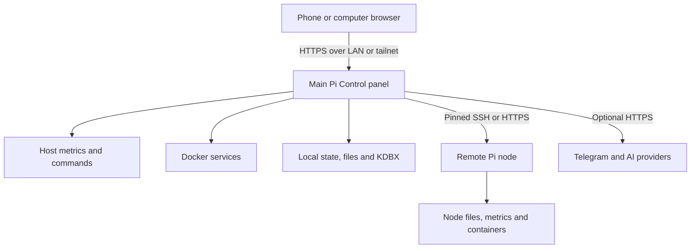
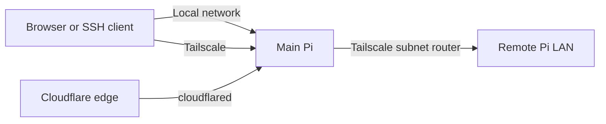
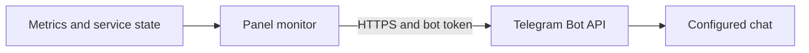

# Architecture and data flows

[Русский](ARCHITECTURE.ru.md) · [User guide](USER-GUIDE.md) · [Installation status](INSTALLATION.md)

This document describes the available source snapshot, not a verified bill of materials for a new deployment. The running installation may differ.

## Components

The browser loads static HTML, JavaScript and CSS from a Python HTTP server wrapped in TLS. The main server implements session authentication and dispatches operations to modules in `src/`. Host metrics use `/proc`, the filesystem and system tools; container status and actions use Docker and host helper commands. The live snapshot assumes specific names and paths; see [installation](INSTALLATION.md).

The lighter remote node is a separate Python service, not a resource pool or an installation of the full main application. Its panel presents basic monitoring, network and route information, `/home` file viewing/downloads and Docker actions. The main panel can also use SSH for supported terminal and file operations.

## Storage and boundaries

| Area | Snapshot implementation / boundary |
| --- | --- |
| Dashboard configuration | Main app expects `/opt/pi-dashboard/dashboard.env`; the actual configuration is excluded from Git. |
| Notes and chat | Local files and SQLite; chat history remains on the host. |
| Password vault | KDBX database accessed through PyKeePass; treat the master password and database as sensitive. |
| Service data | Docker volumes and bind mounts defined by the **missing deployed stack**; must be inventoried before backup or migration. |
| Remote node | Separate password, certificate and session; controller checks a configured certificate fingerprint and SSH host-key fingerprint. |
| Backups | External destination and optional rclone remote; actual helper and restore procedure are not included in the snapshot. |

## Connections

- **LAN:** direct IP or local hostname, subject to each service's bind address and firewall. HTTPS on the panel may use a self-signed certificate. SSH and VNC are separate services, not browser-panel tunnels.
- **Tailscale:** access the Pi's tailnet address directly, subject to device and tailnet policy. A remote Pi can advertise an authorized LAN subnet; the admin must approve the route, the Linux client must accept it, forwarding must work and overlapping subnets must be considered. Test Docker-to-subnet separately; host connectivity alone is insufficient.
- **Cloudflare Tunnel:** the snapshot has quick and named connector controls and a separate temporary file-sharing flow. A tunnel is an outbound connector to Cloudflare, not a general LAN connection. Quick links can be public and anyone holding an unprotected file link may read its contents. Use Cloudflare Access or equivalent authentication before exposing sensitive services. Quick-tunnel URLs and availability are not guaranteed; upload limits depend on the applicable Cloudflare plan and endpoint.
- **Gluetun:** VPN routing for containers configured to share its network namespace. It does not automatically route all traffic of the host, browser, phone or other containers.
- **Offline:** local services and pre-downloaded Ollama models can operate without internet if their dependencies are available; external AI providers, Telegram, remote Cloudflare and an unavailable Tailscale peer require connectivity.

## Information flows

### Status and controls

1. Browser requests status from the authenticated main panel.
2. The panel reads OS metrics, queries Docker and combines the results into cards.
3. An operator action calls a configured Docker command or host helper. The panel reports the operation; actual success depends on the deployed service and helper.

### Local AI and external providers

Chat requests and recent history are passed to Ollama locally or to Groq/OpenRouter over HTTPS. With system context enabled, a small set of read-only diagnostic tools may be called. Remote providers receive the prompt, selected context and tool results; do not include sensitive content unless intended. Agent Zero and n8n are separate services with their own settings and permissions.

### Telegram

The monitoring thread samples approximately every 60 seconds when notifications are enabled. The source defines alerts for temperature **≥80 °C**, disk **≥85%**, available memory **<10%**, current undervoltage and expected Agent Zero/Portainer/PostgreSQL services not running. A continuing alert is limited to one successful notification per category per 30 minutes; a recovered category is cleared. Thresholds are hard-coded in this snapshot. There is **no CPU-usage threshold alert** in the inspected monitor. Delivery requires the panel, network, valid bot token and chat ID; it is not an independent monitoring system.

## Security model and limitations

An authenticated user can trigger high-impact host, file and Docker actions. Do not expose administrative services directly to the public internet without independent access controls. Validate certificates/host keys through a trusted channel, protect the KDBX and API keys, and review source, installed helper scripts and permissions before deployment. Network inventory and diagnostic scans should only target networks for which you have authorization. No independent security audit or complete restore test is included.
