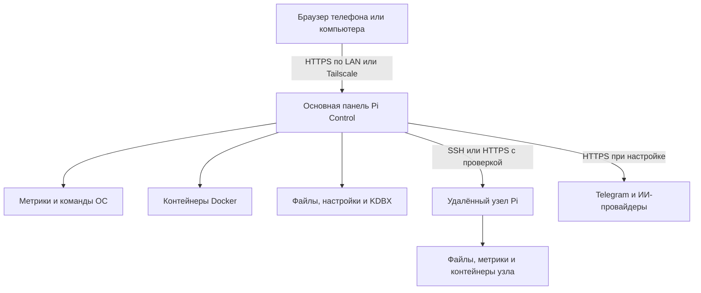
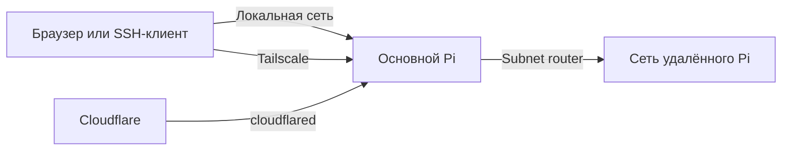
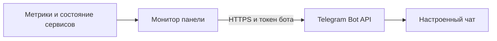

# Архитектура и информационные потоки

[English](ARCHITECTURE.md) · [Руководство пользователя](USER-GUIDE.ru.md) · [Установка](INSTALLATION.ru.md)

Описание основано на опубликованном снимке исходников. Конфигурация действующего Raspberry может отличаться и пока не сверена.

## Состав системы

Браузер получает интерфейс от Python-сервера с TLS. Сервер проверяет сессию и вызывает модули панели. Метрики читаются из ОС; состояние сервисов запрашивается у Docker. Часть действий вызывает скрипты хоста, отсутствующие в репозитории. Облегчённая панель узла — отдельная служба с собственным паролем и сертификатом; она не объединяет память и вычислительную мощность устройств.

| Компонент | Данные и ограничения |
| --- | --- |
| Основная панель | Ожидает конфигурацию в `/opt/pi-dashboard`; приватные файлы не входят в Git. |
| База знаний и чаты | Локальные файлы и SQLite; контент остаётся на устройстве до отправки внешнему провайдеру. |
| Пароли | KDBX через PyKeePass; защищайте файл и мастер-пароль. |
| Сервисы | Данные в Docker-томах и каталогах, заданных развёрнутым стеком; его состав нужно восстановить и проверить. |
| Удалённый узел | Собственные учётные данные; контроллер проверяет заданные отпечатки сертификата и SSH-ключа. |
| Резервирование | Внешний носитель и необязательный rclone; вспомогательный скрипт и проверенная процедура восстановления отсутствуют в снимке. |

## Способы подключения

- **Локальная сеть:** обращение по IP или имени; доступность зависит от адреса прослушивания сервиса и брандмауэра. SSH и VNC работают отдельно от веб-панели.
- **Tailscale:** прямой доступ по адресу устройства в tailnet с учётом политик. Для сети за удалённым Pi нужны объявление и утверждение маршрута, пересылка пакетов и приём маршрутов на клиенте. Проверяйте пересечение подсетей и отдельно доступ из Docker.
- **Cloudflare Tunnel:** исходящее соединение `cloudflared` с Cloudflare для выбранного сервиса или отдельной публикации файла. Это не универсальный доступ ко всей сети. Временная ссылка без дополнительной защиты может быть доступна любому её обладателю. Для приватных сервисов нужна отдельная аутентификация, например Cloudflare Access; ограничения загрузок зависят от тарифа и конкретного маршрута.
- **Gluetun:** VPN только для контейнеров, настроенных на его сетевое пространство. Трафик хоста и телефона автоматически не переключается.
- **Без интернета:** локальная сеть, доступные сервисы и заранее загруженные модели Ollama могут работать автономно. Внешние API, Telegram и Cloudflare без сети недоступны.

## Как проходят данные

При открытии панели браузер запрашивает статус; сервер собирает метрики ОС и Docker. Команда пользователя передаётся серверу, который вызывает соответствующий Docker или системный скрипт. Работа зависит от наличия этих компонентов на устройстве.

ИИ-чат отправляет запрос и часть истории локальной Ollama либо Groq/OpenRouter по HTTPS. При включённом системном контексте доступны ограниченные инструменты диагностики только для чтения. Внешнему провайдеру передаются запрос, выбранный контекст и результаты инструментов. Agent Zero и n8n — отдельные сервисы со своими настройками.

Для Telegram фоновая проверка работает примерно раз в минуту. В коде заданы оповещения: температура **≥80 °C**, заполнение диска **≥85%**, доступная память **<10%**, текущее пониженное напряжение и остановка ожидаемых Agent Zero/Portainer/PostgreSQL. Повтор одного сохраняющегося события — не чаще одного успешного сообщения за 30 минут; после восстановления состояние события очищается. Пороги зафиксированы в коде. **Оповещения по порогу загрузки CPU в проверенном коде нет.** Для доставки нужны работающая панель, интернет, токен и chat ID.

Панель предоставляет выполнение команд, доступ к файлам и Docker. Используйте доверенную сеть, проверяйте отпечатки и не публикуйте административные интерфейсы без дополнительного контроля доступа. Сканируйте только разрешённые сети. Независимого аудита безопасности и проверенного полного восстановления в репозитории нет.
