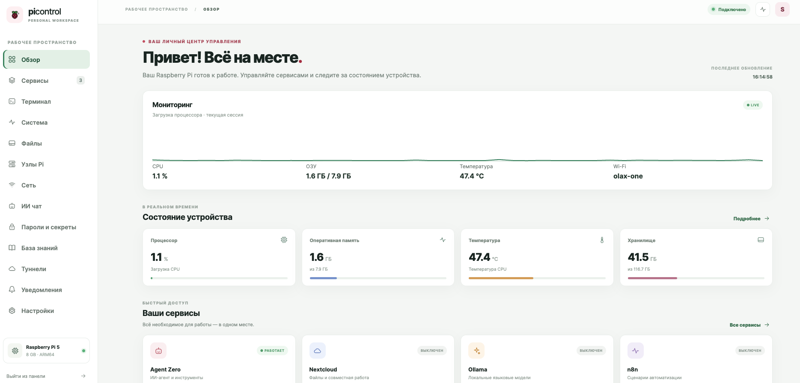
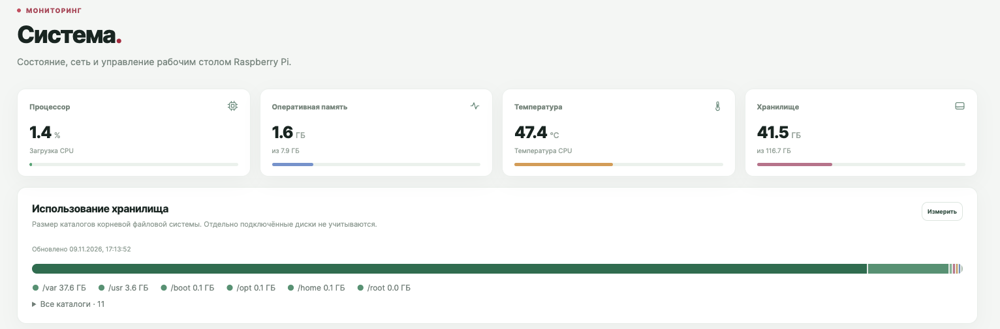
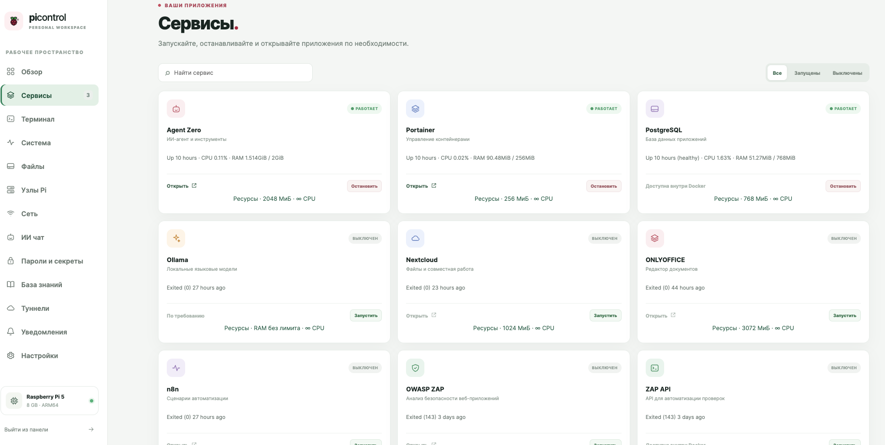

# User guide

[Русский](USER-GUIDE.ru.md) · [Architecture](ARCHITECTURE.md) · [Installation status](INSTALLATION.md)

The examples assume a working existing deployment. Screen labels are currently Russian. Functions depend on the deployed host and integrations; the source snapshot has not been tested as a complete new installation.

## Overview and system

Open **Обзор** for a current CPU chart, memory, temperature, storage and service shortcuts. **Система** provides device information, on-demand directory-size measurement and desktop controls. The disk breakdown covers the root filesystem and does not include separately mounted volumes. The CPU chart in the browser is a current-session view, not historical monitoring.

## Services and resources

In **Сервисы**, find a service, inspect its state and start/stop it. Configured entries include Agent Zero, Portainer, PostgreSQL, Ollama, Nextcloud, ONLYOFFICE, n8n, ZAP, Pi-hole and Gluetun. A card can show CPU/RAM and resource controls where supported. A displayed card does not prove the service is installed or healthy. State, addresses, passwords and persistence depend on the actual installation.

Example: start Nextcloud and ONLYOFFICE when needed; verify integration, credentials, volume persistence and working backups in the applications. Stopping a database while dependent services are running can interrupt them.

## Files

The two panes can display configured main-host roots; in supported browsers the second pane may use a local device folder. Select an item before using copy, rename, delete, permissions, ZIP, extract, preview or Telegram. Availability varies by source and destination. Remote SSH node browsing is restricted to its SSH user's home, with a 1 MiB upload and 8 MiB download cap in the main-panel snapshot. Complete remote file management and direct Pi-to-Pi transfer are not implemented.

Temporary Cloudflare file sharing grants read access to anyone with the link until expiry or stop; test the link and delivery limits and do not share secrets. Browser folder access depends on the browser and permissions.

## Terminal and Pi nodes

Use **Терминал** to select the main host or an added SSH host, then start and stop an interactive session. Idle timeout in the snapshot is 15 minutes. Terminal commands run with the configured account's permissions; SSH sessions use the target account. Never treat model output as permission to execute commands.

In **Узлы Pi**, discover or enter an address and port, verify the SSH fingerprint independently, provide credentials manually or through the vault, and check the device. The auto-setup flow installs a separate lightweight node service on a compatible authorized host with adequate resources and root/passwordless sudo. Inspect status and container controls from the main panel or open the node panel directly. This is not distributed scheduling, and the node's tunnel/settings sections show state rather than full configuration.

## Network and connectivity

**Сеть** and **Настройки** include network inventory and Wi-Fi/Bluetooth functions in the source. Saved or hidden Wi-Fi networks still need a known SSID and credentials; scanning cannot reveal every hidden SSID. Interface selection and automatic scans can affect connectivity. Before changing a route, test a recovery path. Only scan systems you are authorized to assess.

A Tailscale subnet router requires an approved advertised route, IP forwarding, client-side route acceptance and working return/firewall paths. Containers require their own connectivity test. Cloudflare exposes only configured services, while Gluetun affects selected containers. See [architecture](ARCHITECTURE.md#connections).

## AI, knowledge and secrets

In **ИИ чат**, select Ollama, Groq or OpenRouter, choose an available model and manage chat history. Ollama needs an installed model; hosted providers need internet and credentials. Optional system context gives the model a limited set of diagnostic read-only tools. The knowledge area supports notes and a local-model query in this snapshot; completeness of Obsidian/CouchDB sync and hierarchical editing has not been verified.

In **Пароли и секреты**, use KDBX functionality for supported entries and integration. Protect the vault and master password; confirm export and restore on a test copy before relying on them. Some provider settings also write keys to host configuration, so do not assume all secrets exist exclusively in KDBX.

## Telegram alerts

1. Create a bot using Telegram's BotFather and obtain its token securely.
2. Start a conversation with the bot or add it to the intended chat; obtain the correct numeric chat ID through a trusted method. Ensure the bot is permitted to post there.
3. Open **Уведомления**, enter the token and chat ID, enable alerts, save and press the test button. The token stays in host configuration and must not be shared or committed.
4. Confirm reception. The source checks temperature, disk, available memory, undervoltage and selected expected services, with fixed thresholds and rate limits described in [architecture](ARCHITECTURE.md#telegram). CPU percentage is visible but has no threshold alert in the inspected snapshot.
5. No alert can be delivered while internet, Telegram, the panel or the bot configuration is unavailable. Check the actual deployment and use independent monitoring if continuous coverage matters.

## Backups and recovery

Choose an external mounted destination, optional rclone remote and schedule where supported; then run a test and independently validate restoration. The snapshot invokes missing host backup helpers and can stop services during a backup. It does not provide a verified end-to-end restore. A copy on the same SD card is not an independent backup; protect backup encryption keys separately.
