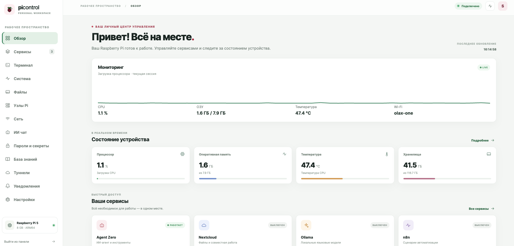
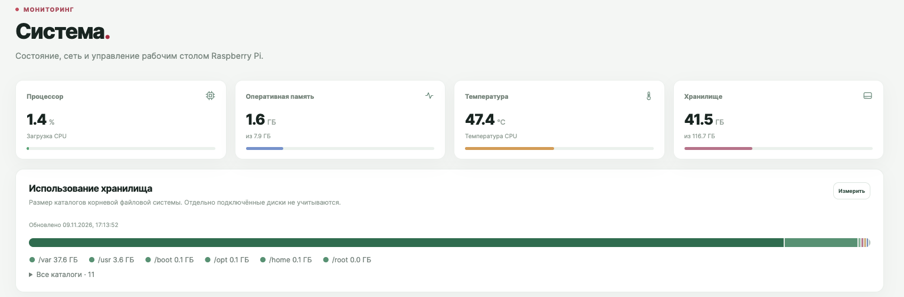
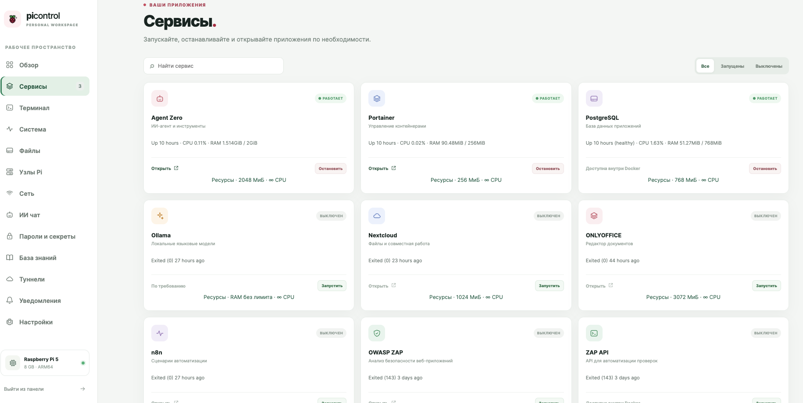

# Руководство пользователя

[English](USER-GUIDE.md) · [Архитектура](ARCHITECTURE.ru.md) · [Установка](INSTALLATION.ru.md)

Примеры относятся к уже работающей панели. Наличие функций зависит от установленных компонентов; полная установка из опубликованного снимка пока не проверена.

## Обзор и система

В **«Обзор»** отображаются график текущей загрузки CPU, память, температура, диск и быстрые ссылки. Раздел **«Система»** показывает показатели и включает измерение размеров каталогов по запросу, а также управление рабочим столом. Анализ размера относится к корневой файловой системе и не включает отдельно смонтированные диски. График CPU в браузере не является долговременной историей.

## Сервисы и ресурсы

В **«Сервисы»** можно найти приложение, посмотреть состояние, запустить или остановить. В коде перечислены Agent Zero, Portainer, PostgreSQL, Ollama, Nextcloud, ONLYOFFICE, n8n, ZAP, Pi-hole и Gluetun. Для поддерживаемых контейнеров доступны показатели и ограничения ресурсов. Наличие карточки не доказывает, что приложение установлено и исправно.

Пример: включите Nextcloud и ONLYOFFICE только на время работы; отдельно проверьте интеграцию, пароли, сохранность томов и восстановление данных. Остановка базы при работающих зависимых приложениях может прервать их работу.

## Файлы

Две панели показывают разрешённые каталоги Pi; в поддерживаемых браузерах вторую панель можно связать с папкой пользовательского устройства. После выбора объекта доступны операции, включая копирование, переименование, удаление, права, ZIP и отправку в Telegram; набор зависит от источника и назначения. Для SSH-узла просмотр ограничен домашним каталогом SSH-пользователя, загрузка — 1 МиБ, скачивание — 8 МиБ в текущем снимке основной панели. Полноценный менеджмент и прямой перенос между Pi ещё не реализованы.

Временная ссылка Cloudflare предоставляет чтение любому обладателю до отключения или истечения срока. Проверяйте ссылку и ограничения передачи, не публикуйте секреты. Доступ к папкам устройства зависит от браузера и его разрешений.

## Терминал и узлы Pi

В **«Терминал»** выберите основной Pi или добавленный SSH-узел и откройте интерактивную сессию. В снимке неактивная сессия завершается через 15 минут. Команды выполняются с правами соответствующего пользователя; вывод модели сам по себе не является разрешением на выполнение.

В **«Узлы Pi»** найдите устройство или введите адрес и порт, независимо проверьте отпечаток SSH, задайте секрет вручную либо через KDBX и проверьте устройство. Автонастройка устанавливает отдельную лёгкую панель на совместимом разрешённом узле с достаточными ресурсами и root или sudo без пароля. Затем проверьте состояние, контейнеры и прямой доступ. Распределения задач между устройствами нет; разделы туннелей и настроек лёгкой панели в основном показывают состояние.

## Сеть и доступ

В **«Сеть»** и **«Настройки»** предусмотрены инвентаризация, Wi-Fi и Bluetooth. Для скрытой Wi-Fi-сети всё равно нужны известные SSID и пароль; сканирование не раскрывает все скрытые сети. Перед изменением подключения обеспечьте резервный путь доступа. Проверяйте только сети, на которые у вас есть разрешение.

Для сети за Pi через Tailscale нужны утверждённый маршрут, пересылка пакетов, приём маршрута клиентом и рабочие правила возврата/брандмауэра. Доступ из контейнера проверяется отдельно. Cloudflare публикует выбранный сервис; Gluetun влияет на выбранные контейнеры. Подробнее — [архитектура](ARCHITECTURE.ru.md#способы-подключения).

## ИИ, знания и пароли

В **«ИИ чат»** выберите Ollama, Groq или OpenRouter и модель; историю можно сохранять и переключать. Для Ollama нужна заранее загруженная модель, для внешних провайдеров — интернет и ключ. Системный контекст открывает ограниченный набор диагностических инструментов только для чтения. В снимке базы знаний есть заметки и запрос к локальной модели; полнота иерархии и синхронизации Obsidian/CouchDB не подтверждена.

В **«Пароли и секреты»** используйте поддерживаемые функции KDBX. Защитите мастер-пароль и файл, проверьте импорт и восстановление на тестовой копии. Часть ключей провайдеров сохраняется и в конфигурации хоста, поэтому нельзя считать, что все секреты хранятся исключительно в KDBX.

## Уведомления Telegram

1. Создайте бота через BotFather и сохраните токен в безопасном месте.
2. Начните диалог с ботом или добавьте его в нужный чат; получите числовой chat ID доверенным способом и проверьте право бота отправлять сообщения.
3. В **«Уведомления»** введите токен и chat ID, включите отправку, сохраните и нажмите кнопку теста. Токен хранится в конфигурации хоста; не публикуйте его.
4. Убедитесь, что сообщение пришло. Код проверяет температуру, диск, свободную память, напряжение и выбранные ожидаемые сервисы; точные пороги и частота приведены в [архитектуре](ARCHITECTURE.ru.md#как-проходят-данные). Загрузка CPU видна на панели, но отдельного оповещения по ней в снимке нет.
5. Без интернета, работающей панели или корректной настройки доставка невозможна. Для непрерывного контроля нужна независимая система мониторинга.

## Бэкапы и восстановление

Выберите внешний смонтированный носитель, при необходимости — rclone и расписание; выполните тест и отдельно проверьте восстановление. В снимке используются отсутствующие системные скрипты, а во время резервирования сервисы могут останавливаться. Полная процедура восстановления не проверена. Копия на той же SD-карте не является независимым бэкапом; ключ шифрования храните отдельно.
